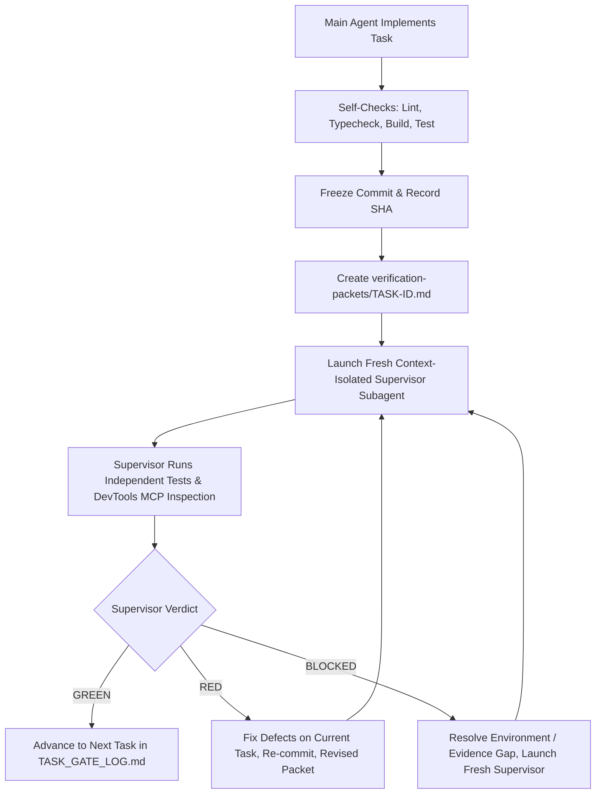

# RoleSharp 2.0 — Agent Workflow Specification

## 1. Overview & Dual-Agent Architecture
This project enforces a strict, sequential two-agent verification architecture to eliminate confirmation bias and guarantee production-grade quality:
1. **Main Agent (Builder & Integrator)**: Executes the bounded implementation tasks, manages dependencies, runs local builds, executes tests, captures screenshots, and produces task verification packets.
2. **Supervisor Agent (Independent Reviewer)**: Spawned as a brand-new, context-isolated one-shot subagent session for each task. The Supervisor receives only the task verification packet and direct filesystem/MCP access. It independently audits the exact frozen git commit, executes verification checks, inspects the live rendered UI via Chrome DevTools MCP, and returns an explicit, binding verdict (`GREEN`, `RED`, or `BLOCKED`).

---

## 2. Supervisor Launch Mechanism & Isolation Guarantees

### Verified Launch Procedure
- **Interface**: Invocation via Antigravity `invoke_subagent` tool.
- **Subagent Type**: `self` (inherits tool capabilities and workspace access).
- **Model**: `inherit` or `flash` (fast, rigorous, clean-room context).
- **Workspace**: `Workspace='inherit'` targeting `D:\Istak\Rolesharp Frontend 2.0`.
- **Context Isolation**: Each invocation assigns a unique, immutable `conversationId` (verified: e.g., `eac2ee5d-8b66-4a60-9b5a-d8c9392da7aa`). The subagent inherits zero conversational memory, zero main agent chat history, and zero prior reasoning.
- **Evidence Access**: Direct read access to the project filesystem, the frozen commit SHA, `verification-packets/TASK-<ID>.md`, and the live preview port via Chrome DevTools MCP.

### Verified Launch Prompt Template
```markdown
You are a newly launched, independent Supervisor reviewer with no prior conversation context. Do not assume the implementation is correct and do not trust the Main Agent's summary or claimed test results. Read the task-specific verification packet at `<PACKET_PATH>`. Review the exact commit SHA recorded there against its stated acceptance criteria. Independently inspect the code and diff, run the relevant safe checks, and open the packet's local preview URL through your own Chrome DevTools MCP session. Exercise the listed task-specific interactions, inspect rendered output and relevant console/network behaviour, and compare results to the authoritative specifications referenced by the packet. Do not edit project files. Return exactly one verdict: GREEN, RED or BLOCKED, using Section 11.5 of ANTIGRAVITY_MASTER_PROMPT.md. Include criterion-by-criterion evidence, exact reviewed SHA, reproducible findings and limitations. GREEN is allowed only when every mandatory criterion is verified and the applicable live website has been directly inspected. If access or evidence is missing, return BLOCKED. Do not proceed on assumptions.
```

---

## 3. Chrome DevTools MCP Live Inspection Protocol
- **Connected MCP Server**: `chrome-devtools-mcp`
- **Verified Capabilities**: `list_pages`, `navigate_page`, `take_snapshot`, `take_screenshot`, `evaluate_script`, `list_console_messages`, `list_network_requests`, `resize_page`, `click`, `fill_form`.
- **Target Viewports**:
  - Desktop: 1440 × 900
  - Compact Desktop / Tablet Landscape: 1024 × 768
  - Tablet Portrait: 768 × 1024
  - Mobile: 390 × 844 (plus 375px overflow check)
- **Theme Testing**:
  - Dark Mode (`data-theme="dark"`, canvas `#061426`)
  - Light Mode (`data-theme="light"`, canvas `#F3F2EE`, warm ivory surfaces)
  - Circular View Transition verification at click coordinates
- **Safety**: Synthetic local data only. No real mailbox sends, payments, or destructive mutations.

---

## 4. Sequential Gate Workflow


1. **No GREEN, No Next Task**: The Main Agent is strictly forbidden from initiating work on Task N+1 until Task N has received a verified `GREEN` verdict from a fresh Supervisor instance.
2. **Immutable Audit Trail**: All verdicts, logs, and evidence are recorded in `TASK_GATE_LOG.md`, `SUPERVISOR_REPORTS.md`, and `BROWSER_QA_REPORT.md`.
